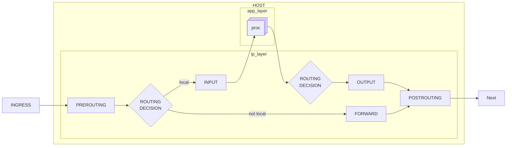

# NFT Learning

## 概述

这是一个 `nftables` 的简单入门教程， 目前还在制作当中。
建议顺序:

- [前置基础](/basic.md)
- [流量过滤](/filter.md)

如果你有任何的改进建议或者希望贡献， 欢迎联系 <2930416610@qq.com>

## Netfilter Chart

## 感谢

该教程参考了, 感兴趣的读者可以查看这些资料

- [arch wiki](https://wiki.archlinux.org/title/Nftables)
- [nftables wiki](https://wiki.nftables.org/wiki-nftables/index.php/Main_Page#Basic_operation)
- [YouTube LinuxCloudHacker nftables 系列视频](https://youtu.be/K8JPwbcNy_0?list=PLUF494I4KUvqwDjhOoP3IFUpgEhE1OVDO)
