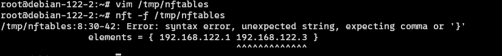

# Basic

这里主要简单介绍一下 `nftables` 当中的重要概念以及它们之间的关系

## 概要

nftables 是现代 Linux 的默认防火墙引擎，使用 `nft` 这个root级别的 cli 进行操作和控制.
相比于传统的 `iptables` 有诸多改进，并且现在支持的 iptables 改动, 底层也是直接跑 nftables

nftables 本身是没有预创建的表和规则的，但是一些发行版会根据需要自己定制规则， 比如说 `fedora` 操作系统就自带 一些规则。

而虚拟机的网络， 以及 一些 vpn 比如说 tailscale， openvpn 等等， 都是依靠 修改nftables的规则来实现其流量的控制效果的。

所以 `nftables` 对于 Linux 网络系统来说极其重要

## Tables

Tables 是一个 容器， 里面会放 `chain` 以及 `set` 或者其他东西。**应当注意的是， 它的存在并不代表执行顺序，而只是进行一种逻辑上的划分**。而各个规则执行的先后顺序是取决于 chain 的 `priority` 而非它属于哪个 table

下面是一些常用的命令

- 列出所有的表

```bash
nft list tables
```

- 创建新表

```bash
nft add table <family_name> <table_name>
# 比如说
# nft add table inet mytable
```

这里的 `family_name` 的值可以是 `ip`, `ip6`, `inet`, `arp`, `bridge`

- 列出表中所有的规则

```bash
nft list table <family_name> <table_name>

# 比如说
# nft list table inet filter 
```

- 清除该表的所有规则

```bash
nft flush table <family_name> <table_name>

# 比如说
# nft flush table inet mytable
```

- 删除一个表

```bash
nft delete table <family_name> <table_name>
```

---

## Chain

Chain 是 `Rules` 的集合， 它按照顺序保存多条规则， 并且在同一个 chain 里面， rule 是从上往下执行的. 不同的 chain 的执行优先级取决于 priority

## Rules

Rule 是对流量进行操作的基础语句， 核心是 当满足什么条件的时候， 对这个流量进行什么样的操作。 通过多条 rule 的组合， 我们可以实现期望的网络防火墙效果。

## Usage

**注意 nft 的所有操作都需要有root权限,并且建议在虚拟机上操作,以免误操作之后断网**

如果真的自己不小心改了规则改不回来导致物理机断网也别慌，只要你没有持久化规则， 直接重启电脑即可恢复正常

我们一般用下面的命令来直接查看现有的所有规则.

```bash
sudo nft list ruleset
```

然后我们会看到诸如这样的规则 (因操作系统以及计算机网络的配置而不同)
当然你也可能完全是空的

```nftables
table inet filter {
        chain input {
                type filter hook input priority filter; policy accept;
        }

        chain forward {
                type filter hook forward priority filter; policy accept;
        }

        chain output {
                type filter hook output priority filter; policy accept;
        }
}
```

我们先简单解读一下这个输出

table inet filter 表示这个 table 的类型是 `inet` 并且名为 `filter`

- inet 包含 `ip` (也就是ipv4) 以及 `ip6` 两个部分
- filter 表示用于控制和过滤外来流量, 名字可以改

chain input 是一个名为 input 的 链(chain) 用于存放规则
实际上这里是没有规则的， 只使用 policy accept; 表示如果没有符合任何的规则，则直接放行流量

---

## 表达式

在 nftables 中有很多表达式，主要包含以下的部分

- meta (meta properties, e.g. interface)
- icmp (ICMP protocol)
- icmpv6 (ICMPv6 protocol)
- ip (IP protocol)
- ip6 (IPv6 protocol)
- tcp (TCP protocol)
- udp (UDP protocol)
- sctp (SCTP protocol)
- ct (connection tracking)

下面是表达式后面会跟上的值 (看不懂没事，到了具体案例的时候会讲解, 现在说只是为了后面可以返回来查表)

```nftables
meta:
  iif <input interface INDEX>
  oif <output interface INDEX>
  iifname <input interface NAME>
  oifname <output interface NAME>

icmp:
  type <icmp type>

icmpv6:
  type <icmpv6 type>

ip:
  protocol <protocol>
  daddr <destination address>
  saddr <source address>

ip6:
  daddr <destination address>
  saddr <source address>

tcp:
  dport <destination port>
  sport <source port>

udp:
  dport <destination port>
  sport <source port>

sctp:
  dport <destination port>
  sport <source port>

ct:
  state <new | established | related | invalid>
```

简单讲解一下常见的

iif 和 oif 分别表示 input interface 和 output interface
也就是输入接口和输出接口. 这边一般是虚拟网卡

daddr 是 destination address 也就是目标的 ip 地址
saddr 是 source address 也就是源 ip 地址

dport 是 目标端口
sport 是 源端口

---

## 原子化重载

很多时候我们希望自己像编辑文件一样来写完所有的改动并一次性全部加载， 如果有规则失败则不会到之前的状态而不是处于中间的状态， 也就是 保证操作的**原子性**

这个时候我们的操作流程是

```bash
# 清除现有的规则 
# 当然这个不是真的清除，文件尚未加载， 只是在操作成功的时候会清除原有内容
echo "flush ruleset" | sudo tee /tmp/nftables

# 把现有规则写入配置文件
nft -s list ruleset >> /tmp/nftables
```

然后就可以使用编辑器编辑 `/tmp/nftables` 这个文件， 进行修改

修改之后进行加载

```bash
nft -f /tmp/nftables
```

这个时候如果配置文件有问题, 会直接报错并不会修改原有的规则


然后根据报错去修改文件重新加载即可

***这样的操作使得我们的网络时刻都处于可用状态***

---

## 下一步

接下来我们会开始学习如何配置 [filter](./filter.md) table
它会帮助我们使用规则来控制外来的流量

但是由于这里需要使用到各种高权限的操作， 所以我们需要使用虚拟机
在每一个章节的开头， 我都会说明网络实验的虚拟机配置，根据条件配置即可
